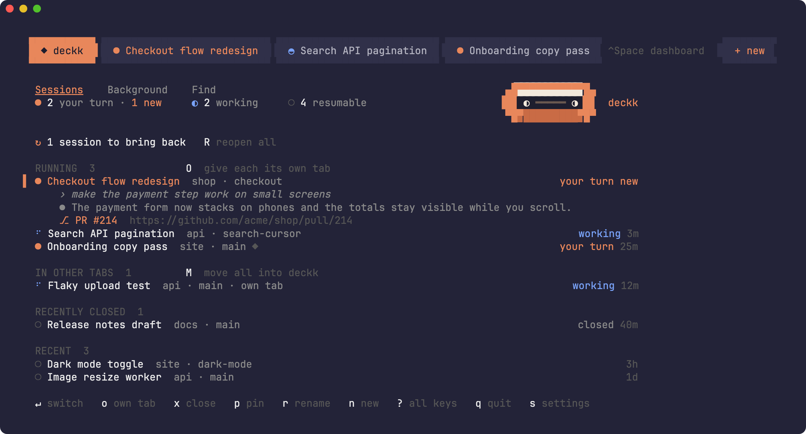
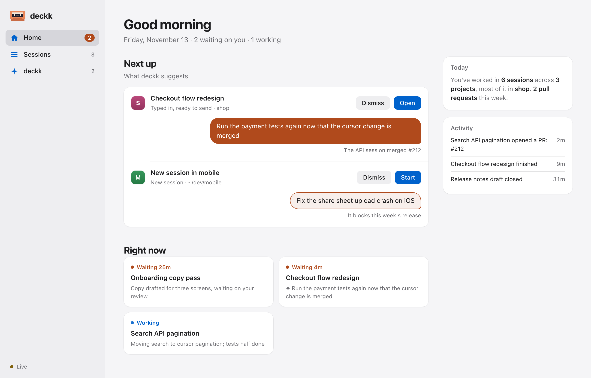

# deckk

All your Claude Code sessions in one terminal tab, and a Claude to help you
run them.



If you run a Claude session per feature, you end up with a row of tabs and no
idea which one is waiting on you. A restart loses all of them. deckk gives you
one tab instead: a dashboard of every session, a tab strip to switch between
the ones that are running, and a way to bring everything back after a reboot.

Beside the dashboard runs the deckk session, a Claude whose job is the other
sessions. It sees what each one is doing, keeps your goals, suggests the next
prompt for each and types it in for you to send. In the browser, deckk becomes
a hub where you can follow, find and write to every session and talk to the
deckk session.

## Install

```sh
brew tap theowecker/tap
brew trust --cask theowecker/tap/deckk
brew install --cask deckk
```

Homebrew asks you to trust casks from taps outside its main repo before it
will load them, which is what the middle line does.

Then run `deckk`. It needs macOS and uses tmux, which Homebrew installs for
you. deckk runs its own tmux server with its own config, so it won't touch any
tmux setup you already have. To upgrade, run `brew update`, then
`brew upgrade --cask deckk`. When Homebrew upgrades tmux itself, deckk's
tmux server keeps running the old version, which the new tmux can't attach
to; the next time you run `deckk` it offers to restart the server. If
something seems off, `deckk doctor` checks what deckk depends on and says
how to fix what's missing.

## Use

Run `deckk` from any terminal. Running it again brings you back to the same
place.

| Key | Does |
| --- | --- |
| `↵` or double-click | open a session, or resume it if it isn't running |
| `n` | start Claude in a folder, or find an old session to resume (→ shows a folder's sessions) |
| `x` | close a session (it stays resumable) |
| `p` / `r` | pin or rename a session |
| `R` | reopen what was open before a reboot or restart |
| `o` / `O` | give one session, or all of them, its own terminal tab |
| `m` / `M` | bring one session, or all of them, back into deckk |
| `c` | talk to the deckk session |
| `d` | dismiss the deckk session's suggestion for a session |
| `t` | let the deckk session send its safe suggestions to a session without asking |
| `e` | review a session's changes against what it says it did |
| `w` | open deckk in your browser |
| `/` | find any session, ever: titles first, then folders and branches, then what was said, then anything in the whole conversation |
| `tab` | switch between Sessions, Board, Background and Find |
| `v` | group by status or by project |
| `s` | settings |
| `?` | all keys |
| `q` | quit (sessions keep running) |
| `⌃Space` | flip between the dashboard and your last session |
| `⌃⇧←` / `⌃⇧→` | previous or next tab (also `⌘⇧←` / `⌘⇧→` in iTerm2) |
| `⌃⇧↑` / `⌃⇧↓` | move between the list and the deckk session |
| drag a tab | drop it on another tab to move it there |

Click a tab in the strip to switch to it. On the dashboard, `1` to `9` jump to
a tab too.

`O` and `M` move every session, so they ask first: press them again to go
ahead. Letters typed in a quick run never count as shortcuts, so a sentence
meant for the deckk session can't rearrange your tabs.

Drag over text to select it, or double-click a word, then press Ctrl+C to
copy. In iTerm2, Cmd+C works too, and Cmd+F searches a session's whole
history, with Cmd+G for the next match; on the dashboard it opens Find.
Ctrl+Shift+F and Ctrl+Shift+G do the same in Ghostty and other terminals
that report Shift with Ctrl, where Cmd+F stays the terminal's own search of
the screen. Right-click a
session for Copy, Paste, Find and Scroll to bottom. To select more than a screen, scroll and
shift-click where the selection should end. Click anywhere to clear it, or
just type: keys go to Claude whether or not you've scrolled back.

## What the dashboard keeps track of

- **Status.** Each session shows whether Claude is working or waiting on you,
  and for how long. A session that finished while you were elsewhere is marked
  new until you open it, and macOS tells you, at most once a minute for each
  session. Click the notification to go straight to that session.
- **Context.** The selected row shows your last prompt, Claude's latest reply
  and any pull request it opened. Under the tab strip, each tab shows how long
  it has been working or waiting, its folder, branch, uncommitted changes,
  commits ahead or behind, worktree and pull request, and on the right the
  model, effort, permission mode, context size and uptime.
- **Clashes.** When two running sessions edit the same files, deckk warns you
  above the list and on both tabs. Sessions that only share a folder get a
  quiet note in the preview.
- **Pins.** `p`, or the pin button under a tab, saves a session to the Pinned
  list, where it stays after you close it until you unpin it. A pinned tab
  shrinks to its first word and moves up next to the deckk tab.
- **Sessions in other tabs.** Claude sessions started outside deckk show up
  too, and `m` moves them in.
- **Background runs.** Sessions nobody is typing into, such as `claude -p`
  runs, SDK runs, plugins and scripts, get their own Background view so they
  don't crowd your own. Find still searches everything.
- **Restarts.** Sessions in deckk keep running if you quit your terminal.
  After a reboot, or when tmux itself restarts, the dashboard lists what was
  open and `R` reopens exactly that, each session once. Sessions you closed
  stay closed; the last day's are listed under Recently closed to reopen one
  by one.

## The deckk session

Beside the list runs one more Claude, the deckk session. It sees every
session, what each one just did and a goals file it keeps with you, so you can
ask it what needs you, where you left off on a project, or what to do next
across all of them. Click its side or press `c` to talk to it. The side you
aren't using fades, so it's always clear where your typing goes.

It also works on its own:

- **Suggestions.** When a session finishes a turn and the next step is clear,
  it suggests a prompt. deckk types the prompt into that session while you're
  looking elsewhere, without sending it, so it's ready when you switch over.
  Edit it, clear it or press Enter. Sessions with a suggestion are listed under
  Next up and marked ✦.
- **Proposals.** It can propose a new session in a folder with its first
  prompt, or picking a stopped session back up. Those wait under Next up too,
  and `↵` starts one with the prompt typed in.
- **Clashes.** It hears when two sessions edit the same files, so it can
  suggest which one should wait.
- **Briefings.** When you open deckk after a few hours away, it gives you a
  short briefing on what's waiting and what to pick back up.
- **Reviews.** `e` on a session, Review changes in the browser, or the deckk
  session's `review_session` tool gives its work a quick sanity check: a
  small model reads what the session says it did and its branch's changes
  since main, and answers OK or lists what looks off. The result shows on the
  Board and the session list, under the session's tab, in the browser and in
  the deckk session's inbox, and macOS tells you when a review of a session
  you aren't watching finds something. By default a session is also reviewed
  on its own when it opens a PR or finishes a turn saying its work is done;
  `reviews = "manual"` keeps reviews to when you ask, and `reviews = "auto"`
  reviews after every turn that leaves changes. Unchanged work is never
  reviewed twice.
- **Questions.** Sessions deckk starts can ask it what to do next with an
  `ask_deckk` tool and wait for its answer, or leave it a note with
  `tell_deckk`.

Suggestions wait for you by default. Press `t` on a session you trust, or
turn on Auto-send in the browser, and the deckk session's suggestions for it go
out on their own when it judges them safe. Text that would run a command is
never sent, and the session is marked ⇢ while this is on.

It answers in briefs: a headline, then what needs you, what's in flight,
what's blocked and what's next, with detail when you ask for it.

It keeps a short note on each session it has looked at, so it only rereads
sessions that moved since. The notes show in each session's preview, and the
**Board** tab lays them out with your goals: every project touched this week,
how its sessions stand, and one line on each.

It never types into a prompt you've started, into the tab you're on, or into
the deckk session while you're talking to it, and it never sends text that
would run a command. Every update it hears about costs it a turn, so updates
arrive at most every 90 seconds, batched. Its files, including `goals.md` and
a `CLAUDE.md` you can add to, are in `~/.config/deckk/hq`. The first time it
starts, Claude asks you to trust that folder.

## Your hub in the browser



Press `w`, or click Web ↗ next to the view tabs, to open deckk in your browser.
It is the same deckk with room to spread out, and you can work from it:

- **Home** says what needs you. Next up shows each suggested prompt as the
  message you'd send, Right now has a card for every session that is waiting
  or working, and clashes, today's work and recent activity sit alongside.
- **Sessions** finds and keeps your sessions. Search every session Claude has
  kept, group them by status or project, or look at background runs on their
  own. Open one to see its recent conversation and write to it. deckk's
  suggestion waits above the message box: click it, or press Tab, to put it
  in the box, then edit it or press Enter to send. Option+Enter types it into
  the session without sending. A stopped session resumes first. Open, pin,
  rename, close and archive from there too, or start a new session in any
  folder with its first prompt.
- **deckk** is a chat with the deckk session, and the goals it keeps with you,
  which you can edit.

The page updates live, and what you do there happens in deckk the same way
the keys do. It answers only on `127.0.0.1:4747`. deckk's link carries a
one-time code after the `#`, which the page trades for the token kept in
`~/.config/deckk/web.token`, so only spent codes ever reach your browser's
history. The page keeps the token for later visits, so the bare page can be
bookmarked, and other pages in your browser can't use it.

## Settings

Press `s` to set the view, model, effort and permission mode for every Claude
that deckk starts, the keys that switch tabs, and how the deckk session and
the web view behave. Changes apply at once. Settings live in
`~/.config/deckk/config.toml`:

```toml
view = "focus"
model = "opus"
effort = ""
permission_mode = "acceptEdits"
extra_args = "--add-dir ~/shared"
days = 30
tab_keys = ""
deckk_session = ""
suggestions = ""
updates = ""
sessions_ask = ""
web_view = ""
notifications = ""
reviews = ""
```

An empty value leaves it to your normal Claude settings, or to deckk's
default.

| Setting | Does |
| --- | --- |
| `extra_args` | added to every `claude` command deckk runs |
| `days` | how far back the dashboard lists sessions |
| `tab_keys` | empty for ⌘⇧← ⌘⇧→, `brackets` for ⌘⇧[ ⌘⇧], `pageup` for ⌃PgUp ⌃PgDn, or `off` |
| `deckk_session` | `off` closes the deckk session; nothing is suggested, typed or sent for it |
| `suggestions` | empty types them in for you to send, `send` also sends the ones it marks safe, `list` only lists them under Next up |
| `updates` | `off` stops telling the deckk session about changes, so it only acts when you ask |
| `sessions_ask` | `off` leaves the `ask_deckk` tools out of sessions deckk starts |
| `web_view` | `off` stops the hub's server |
| `notifications` | `off` stops the macOS notification when a session you aren't looking at starts waiting on you |
| `reviews` | empty reviews a session when it says its work is done or opens a PR, `manual` only when you ask, `auto` after every turn that leaves changes |

The ⌘ keys for switching tabs take over iTerm2's own use of them, but only in
the deckk tab.

## Terminals

deckk runs in any terminal. In iTerm2, Ghostty 1.3+ and Terminal it can also
open, find and close tabs for you:

| When deckk runs in | iTerm2 | Ghostty | Terminal | Others |
| --- | --- | --- | --- | --- |
| Dashboard, tabs, resume, restore | yes | yes | yes | yes |
| `o` moves a session to its own tab | yes | yes | a window | no |
| Copy a selection | Cmd+C | Ctrl+C | Ctrl+C | Ctrl+C |
| Search a session's history | Cmd+F or Ctrl+Shift+F | Ctrl+Shift+F | no | Ctrl+Shift+F, if it reports Shift |
| Terminal's own selection | Option-drag | Shift-drag | Fn-drag | varies |

Claude sessions running in iTerm2, Ghostty or Terminal tabs show up on the
dashboard wherever deckk runs, and `↵` jumps to them.

The first time deckk controls a terminal, macOS asks whether to allow it.

## How it works

deckk reads what Claude Code already writes to disk:
`~/.claude/sessions/*.json` for running sessions and
`~/.claude/projects/*/*.jsonl` for transcripts. These formats aren't
documented, so a Claude Code update can break deckk. The parsing is all in
`internal/claude`.

The deckk session gets its tools from `deckk mcp`, a small MCP server in
`internal/mcp` with the tools themselves in `internal/hq`. The same server
gives other sessions `ask_deckk` and `tell_deckk`, by the role named in its
config. Suggestions, proposals, notes, the inbox and questions are plain files
in `~/.config/deckk/hq`. deckk types into a session's prompt only after
reading the pane to check the prompt is empty or still holds its own text.

The browser hub is plain HTML, CSS and JavaScript built into the binary and
served with Go's own HTTP server, in `internal/web`.

Each terminal deckk can drive is a few lines of AppleScript in
`internal/terminal/apps.go`, so adding one is a small change.

In iTerm2, the deckk tab uses a "deckk" profile so that Cmd+C goes to deckk.
The profile copies everything else from the profile you started in, except
iTerm2's own scrollback, which it turns off because tmux keeps each session's
history, and triggers inside full-screen apps, which slow iTerm2 down as tmux
redraws. deckk switches back when you quit. It lives in
`~/Library/Application Support/iTerm2/DynamicProfiles/deckk.json`.

The mouse pointer changes over clickable things in Ghostty and in iTerm2 3.7
and later.

## Development

```sh
go test ./...
golangci-lint run
go build -o bin/deckk ./cmd/deckk && bin/deckk
script/screenshot   # rebuild docs/screenshot.png and docs/hub.png
```

`DECKK_SOCKET=deckk-dev` runs a second deckk on its own tmux server beside
your real one. Add `XDG_CONFIG_HOME` pointing at a scratch folder to keep its
settings and state apart too.

Pushing a `v*` tag builds a release and updates the Homebrew tap.

## License

MIT
